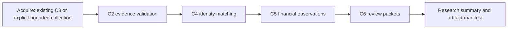

# Phase 3C7: reproducible research workflow

The integration plan wraps existing C1–C6 contracts with stage commits, not new
matching/reconciliation rules. One research run may contain several independently
validated flat C3 collections. No cross-collection identity merge is introduced.



The actual adapters revalidate earlier evidence by design. A C4 result is not an
authorization to trust stale C3 bytes; C5 and C6 recompute their prerequisites.
Exit 1 in these components often means technically valid processing with limited
evidence. C7 records this separately from integrity, execution and reporting
failures. No existing CLI, checkpoint, schema, report or default is replaced.

At each orchestration boundary, immutable stage artifacts and an exclusive commit
record bind input/configuration digests and output byte hashes. Orphaned output
directories are not adopted without a commit. Explicit retry uses a new attempt,
preserving failed/partial outputs. C3 collection resume remains delegated to C3;
no HTTP operation is replayed by C7. Technical completion never means a complete
contract history, current source agreement, source authenticity or misconduct.

## Quick start: one command, no internet

From the repository root with the existing dependencies installed:

```sh
mkdir -p reports
.venv/bin/python -m src.research_pipeline --demo --run-dir reports/NEW_research_demo
```

This generates six fictional collections and all six stages, including standalone
C6 HTML. It does not import tests or depend on uncommitted datasets. All source
responses carry synthetic provenance. **Exit 1 is expected**: the demo completes
technically but deliberately contains ambiguity and insufficient evidence.
It is not a failed demo and is not a statement about government spending.

For just the exact-observed-agreement case:

```sh
.venv/bin/python -m src.research_pipeline --demo --demo-case agreement --run-dir reports/NEW_agreement_demo
```

That case exits 0 for its narrow saved claims while still reporting
`evidentiary_complete: false`. History, source-wide completeness, freshness and
source authenticity remain unknown. There is no fraud probability score,
accusation, contractor graph, automatic publication or external outreach.

To process existing preserved evidence without collection:

```sh
.venv/bin/python -m src.research_pipeline --evidence data/raw/c3/EXISTING_RUN --run-dir reports/NEW_existing_research
```

Repeat `--evidence` up to ten times for independently validated flat C3 roots.
Inputs are labeled `input-000`, `input-001`, etc., in explicitly supplied order.
No cross-collection award/action merge or new matching algorithm is introduced.
Identical saved observation contexts are counted once in the distinct-context
metric, while physical entries/record occurrences and all source paths remain
available. Conflicting payloads under the same documented observation ID fail
verification; content equality alone never creates a retrieval identity.

### Find your results

The CLI prints bounded structured stage progress on stderr and a final JSON
summary on stdout. `research-run-000000.json` is the initial versioned run report;
subsequent invocations append the next numbered report without replacing it.
The wrapper includes technical completion, evidentiary completeness, exit code,
substantive digest and a typed `ResearchRun`.

| Artifact | Purpose |
|---|---|
| `research-plan.json` | Immutable execution configuration, versions and source locations |
| `evidence/<label>/` | Managed C3 evidence for demo/live; existing external evidence is never copied or rewritten |
| `artifacts/acquire/attempt-NNN/acquire.json` | Evidence identities, explicit selections and query/limit context; no invented identity verification |
| `artifacts/verify/attempt-NNN/<label>/evidence.json` | Existing C2 evidence/provenance inventory |
| `artifacts/identity/attempt-NNN/<label>/identity.json` | Existing C4 typed matching results |
| `artifacts/finance/attempt-NNN/<label>/finance.json` | Existing C5 exact observations/comparisons |
| `artifacts/packets/attempt-NNN/<label>/review.html` | Existing C6 standalone human-review report, with its JSON/history/commit sidecars |
| `artifacts/summary/attempt-NNN/summary.json` and `.txt` | Metrics and readable next checks; authoritative status also requires the summary stage commit and final run manifest |
| `stage-<stage>.json` | Immutable stage commit, dependency digest and output byte hashes |
| `failures/<stage>-NNN.json` | Bounded sanitized failure diagnostic; partial artifacts remain in their attempt |

For an uninterrupted demo, open
`reports/NEW_research_demo/artifacts/packets/attempt-000/agreement/review.html`.
Use `stage-packets.json` to find the exact committed paths after a retry. The
final manifest also lists logical artifact names, actual storage paths, sizes
and hashes. Generated reports/evidence remain ignored and must not be committed.

## Actual adapter contracts

| Stage | Consumed contract | Produced contract / completion meaning |
|---|---|---|
| acquire | Existing C3 roots, or explicit `SelectedAward` + C3 `CollectionLimits`; authored fixture transport only in demo mode | `ResearchInput` snapshots and C3 journals; completion means the bounded acquisition step finished, not that queries/histories are complete |
| verify | C3 plan/checkpoint/attempts and preserved bytes | C2 `IngestionManifest`; invalid/unsupported/missing integrity blocks downstream stages, while a valid preserved source failure can remain an explicit incomplete observation |
| identity | One validated flat C3 collection per input | C4 `MatchRunSummary`; limits and C2 manifest digest must agree |
| finance | C3 plus the committed C4 report | C5 `FinancialRun`; nested C4 substantive digest/configuration must agree; unknown semantics never become deltas |
| packets | C3 plus committed C4/C5 reports | C6 `ReviewPacketManifest` bundle; C5 digest/claim selection, byte commit and safe HTML projection must agree |
| summary | Validated committed outputs | Typed run metrics, gates and final `ResearchRun` references; no independent monetary calculation |

Input/output shape checks run **before** a stage receives its commit. Required
filenames are allowlisted per stage. Byte hashes alone cannot substitute for
schema, version or dependency checks. Completed artifacts are revalidated on
resume; C4 cannot silently authorize stale C3 evidence, C5 cannot consume a stale
C4 snapshot, and C6 cannot consume different C5 findings. A stage cannot run
after a failed dependency; later states are explicitly blocked. Arbitrary stage
reordering/skipping is unsupported in v1.

C4/C5/C6 deliberately rerun portions of earlier adapters. C7 keeps this defense
instead of adding unsafe cache bypasses or independently implementing identity,
money, rounding, provenance or HTML logic. Their existing CLI wrappers differ:
C7 stores the underlying typed contracts directly, which their readers already
support. C3 checkpoint semantics remain entirely C3's responsibility.

## Reproducibility and manifests

`ResearchRun`, `ResearchConfig`, `ResearchInput`, `ResearchStage`,
`ResearchArtifact`, `ResearchDiagnostic` and `QualityGate` are strict schema-v1
companions. `research-pipeline-v1` and the C1–C6 compatibility/rule versions are
recorded. Actual input collector versions remain in each input's scope; old
readable C3 evidence is not relabeled as newly collected v2 evidence.

The configuration also records a bounded SHA-256 fingerprint over the repository
`src/*.py` implementation. Changed code or incompatible versions require a new
run, rather than silent reuse. This fingerprint is not a signature, git commit
attestation or guarantee about compiled/imported code, dependencies or the host.
The source repository installation is required; zipped/unsupported installations
and symlinked source files fail explicitly. Retain the reviewed commit and
environment/dependency versions when sharing research.

The run ID hashes configuration, versions and validated input identities, not
physical directory names or execution timestamps. A failure before acquisition
finishes has only a provisional configuration-bound identity; after inputs are
established, the snapshot ID is stable. Actual retrieval timestamps, requests,
source IDs and byte/content digests remain substantive. A copied saved collection
retains its original observation IDs; copying is not another real-world request.

Operational storage paths and optional `--execution-time` are separate metadata
excluded from the substantive output digest. Retry-attempt locations therefore
do not change the substantive result when the validated inputs/outcomes remain
the same. Wire manifests include these paths for inspection; the substantive
projection is for hashing, not a substitute wire schema.

Identical demo inputs/configuration/code produce the same run ID, stage output
content hashes and substantive final digest in different new directories:

```sh
.venv/bin/python -m src.research_pipeline --demo --run-dir reports/NEW_demo_a
.venv/bin/python -m src.research_pipeline --demo --run-dir reports/NEW_demo_b
```

Compare the two final wrapper `substantive_sha256` values. Fresh live retrievals
can legitimately differ even when the response content happens to repeat.

## Resume and explicit safe retry

```sh
.venv/bin/python -m src.research_pipeline --demo --run-dir reports/EXISTING_demo --resume
# After inspecting an interrupted/failed attempt, with the same configuration:
.venv/bin/python -m src.research_pipeline --demo --run-dir reports/EXISTING_demo --resume --retry-failed
```

All original flags/selections/limits must match; resume/retry/execution-time are
operational flags. A changed input, output, configuration, rule/source checksum
or invalid commit is rejected before reuse. New input evidence, corrected input
metadata or intentional configuration/code changes require a **new** research
run. Do not edit evidence, delete failed attempts or repair hashes to resume.

Completed stage files and review records are never overwritten. An uncommitted
attempt is not adopted even if it looks complete. Explicit retry creates a new
attempt and preserves the old one; at most five attempts per stage are allowed
by default (hard cap twenty). A commit that completed before interruption can
be reused after validation without rerunning its stage. During interrupted live
collection, C7 passes the identical plan back to C3 resume, including its
uncertain-reservation accounting; C7 itself never reissues an HTTP request.

Files are exclusively created, fsynced and atomically published individually.
Neither stages nor the entire run are a whole-directory transaction. A partial
plan initialization, partial C3 evidence or corrupt commit can block recovery;
preserve it for inspection and use a new run where documented by C3/C7. An
unexpected failure after publication may leave a valid commit: inspect it before
retrying. There is no non-idempotent automatic retry policy.

## Synthetic scenario coverage and negative demonstrations

- `agreement`: complete native identity and compatible exact action values.
- `financial_gap`: verified action identity with unequal compatible values;
  unknown source version alignment keeps the result insufficient.
- `ambiguous_parent`: incomplete USA parent context and two FPDS parent candidates.
- `modifications`: separate positive, negative/deobligation and zero-dollar actions;
  cumulative obligations/ceilings are inventory, never substituted or summed.
- `scope_mismatch`: FY/lifetime inventory fields are unsupported for action
  comparison, and different signed dates cross a fiscal-year boundary.
- `duplicates`: identical whole response content at distinct synthetic response
  observations (503/200), plus a repeated transaction row on another page;
  observations and records remain distinct concepts. History/freshness stay unknown.

The full demo intentionally uses fixed, recorded C3 fixture limits: two pages,
ten attempts, 100 total requested record slots, 40 per-source slots and one retry
per collection. The six collections are independent and offline; these are not
live collection defaults. Collection-limit overrides are accepted only in live
mode, never silently ignored/expanded in demo or existing-evidence mode.

Optional negative runs publish a **new explicitly synthetic damaged copy** of
the agreement collection, leaving its original bytes intact:

```sh
.venv/bin/python -m src.research_pipeline --demo --demo-case agreement --demo-damage missing --run-dir reports/NEW_missing_demo
.venv/bin/python -m src.research_pipeline --demo --demo-case agreement --demo-damage tampered --run-dir reports/NEW_tamper_demo
```

Both should exit 2 at verification, with later stages blocked. The missing case
omits a response body when the copy is first written; the tampered case writes
an intentionally mismatched body in the new copy. No original source evidence
is modified. This feature is unavailable outside demo mode.

## Explicit bounded live research

Provide an authored C3 selection file with exact generated award ID, PIID and
agency strings, and paired parent identifiers if supplied. No agency crosswalk,
contractor-name inference or user URL is accepted. Use a **real researched public
selection**, not the fictional IDs in demo files:

```sh
.venv/bin/python -m src.research_pipeline --live --selection work/selected-public-awards.json --run-dir reports/NEW_live_research --max-pages 1 --max-records-total 20 --max-requests 2 --retries 0
```

`--live` is the explicit authorization boundary. It never follows from API
availability, a missing local file, a failed demo or an unavailable source.
Only C3's official fixed endpoints, TLS/proxy/CA settings, redirects restriction,
timeouts, pacing, retries, request reservations and response preservation are
used. There is no fallback to synthetic records or alternate/authenticated APIs.

Defaults retain C3's three-award, two-page, thirty-slot, ten-attempt limits. C7's
live policy additionally caps three awards, five pages, thirty attempts, 100
requested slots, fifty per-source slots/page size and two retries; the actual
default per-source cap remains ten. The global run budget must reserve a
conservative worst-case body/summary capture allowance before any live request.
Lower request limits or a larger permitted run budget may be needed; no budget
is silently increased. These bounds do not establish complete query support,
historical coverage or current endpoint availability.

Preserved source errors can still pass structural validation and proceed offline
as explicit incomplete evidence. Irrecoverable collection/checkpoint errors stop
the stage. No restriction is bypassed, no findings are published, and no person
or organization is contacted. Live API validation is optional and must be
reported separately from fixture tests; the implementation's live-boundary tests
use an explicitly synthetic injected transport, not government data.

## Quality gates, summaries and exit codes

The summary includes unique exact selection rows and total selection rows,
unknown scopes, physical observation entries, distinct documented retrieval
contexts, usable observations, retrieved row occurrences, C4 claim statuses,
unassociated FPDS records, C5 compatible **authorized numerical comparisons**,
observed agreements, nonzero deltas requiring evidence, insufficient financial
claims, packet counts and source diagnostics. Field-compatible candidates without
identity authorization are counted separately; they are not numerical comparisons.
Counts are not a census of contracts or independent payments.

Required-stage, integrity, committed-output, critical-provenance, identity and
narrow-financial-claim gates must pass for exit 0. Unassociated records, missing
usable declared-source observations, exclusions, ambiguity and insufficient
claims prevent a clean narrow-claim result. History, freshness and authenticity
gates remain unknown: `evidentiary_complete` stays false. Never interpret exit 0
or `technical_success` as complete finances, proven source authenticity or a
wrongdoing conclusion.

| Exit | Meaning |
|---|---|
| 0 | All stages committed; narrow saved-claim gates passed, with broader limitations still explicit |
| 1 | All stages committed technically, but evidence/claims remain unresolved or incomplete |
| 2 | Configuration, integrity, parsing, storage, identity, financial or reporting execution failure; dependents blocked |
| 130 | Interrupted; preserved state requires inspection/resume policy |

Diagnostics use fixed stage/category/code fields, not raw exception text, response
bodies, credentials or headers. Progress is bounded to stage boundary events.
Preserved source-network diagnostics are capped at 100 visible entries with
explicit total/omitted counts; complete evidence is not dropped. Unexpected errors
produce an explicit failed stage, not a silent skip or success.

## Troubleshooting and operational limits

- **API unavailable/empty feed:** inspect C3 metadata and C6 exclusions; empty
  FPDS feeds remain inconclusive. Process already preserved valid evidence with
  `--evidence` in a new run. Do not disable TLS/proxy protections or infer absence.
- **Missing/tampered evidence or provenance:** verification blocks downstream
  stages. Preserve the damaged directory; obtain independently valid evidence
  and start a new run. Missing timestamps never become the execution time.
- **Stale C4/C5/C6 output:** byte and semantic cross-stage checks reject it even
  if a simple file checksum was repaired. Do not replace immutable reports.
- **Interrupted stage:** inspect the attempt/commit/failure records, then resume
  with identical configuration and explicit `--retry-failed` when uncommitted.
- **Failed C3 checkpoint:** follow C3's conservative recovery rules. Unknown
  request outcomes consume their budgets. Partial temporary/source files may
  require a new collection rather than repair or deletion.
- **Output limit:** configure a new run with explicit claim selection/output
  limits. C6 bundle and C7 global limits fail rather than truncate claims.
- **Changed code/configuration:** use a new run; compatibility fingerprints are
  not waived automatically. Keep reviewer logs outside the managed run, evidence
  and packet directories; use C6's separate review CLI without editing bundles.

POSIX/Linux/WSL is required by existing secure IO/locking. Native Windows has no
insecure fallback; use WSL. No new dependency is added. C2–C6 bounds remain in
force. C7 allows ten inputs, 100 default/1,000 maximum packet sections, 8 MiB
default/32 MiB maximum per C6 bundle, 256 MiB default/512 MiB maximum managed run,
32 MiB per managed file, 12,000 managed filesystem entries and 100 invocation
reports. Output sizes are checked before controlled publication; external-source
and delegated collector limits also apply. Filesystem/network limits are not
an atomic storage reservation or a total wall-clock guarantee.

Paths use descriptor-relative no-follow IO, exact output contracts, exclusive
publication, immutable commits and a single-writer advisory lock. Path traversal,
symlinks, hard-linked inputs, changed controls and foreign artifacts fail closed.
C6 HTML escaping, CSP, official-link restrictions and review-event separation
remain intact. No reviewer assertion changes an automated finding.

## Glossary and remaining limits

- **Award identity:** source-native contract context, including agency/parent
  where required; PIID alone is not sufficient.
- **Action identity:** a specific transaction/modification within an established
  award association; similar dates/amounts are not identity keys.
- **Obligation/deobligation:** funds obligated or reduced by a reported action;
  neither is a payment, outlay or contract ceiling.
- **Provenance:** preserved source/request/representation/time/locator context;
  unknown fields stay unknown and a body hash is not authenticity proof.
- **Coverage:** what the bounded query/retrieval actually observed, separate from
  pagination, transaction history and source-wide completeness.
- **Freshness:** source update/revision alignment, not merely recent retrieval.

Inherited parent-absence/encoding, monetary-field, revision, history and source
refresh uncertainties remain unresolved. The pipeline does not infer missing
transactions, total award finances, wrongdoing or causal explanations. Its
hashes/locks do not protect against a privileged actor coordinating edits to all
data/declarations, nor provide an atomic upstream snapshot. Saved review history
has no authentication/signature guarantee. No unrelated future workstream is
implemented.
